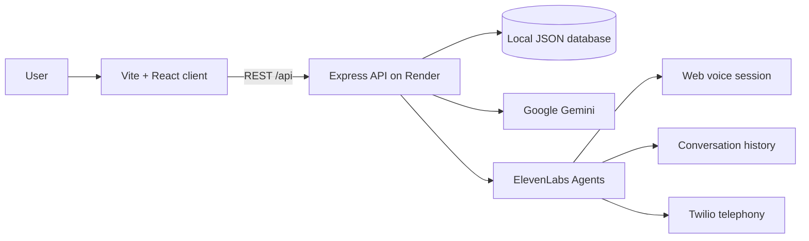

# VoiceCraft

VoiceCraft is a no-code voice AI agent builder. Describe an assistant in plain language, generate its agent specification, test it with simulated callers, refine it conversationally, deploy it to the web or phone, and review conversations.

## Architecture



## Features

- Plain-language agent generation with Google Gemini JSON output
- Agent versioning, refinement, flow editing, guardrails, and knowledge base attachments
- ElevenLabs Agents for conversational orchestration
- ElevenLabs TTS for natural agent speech
- ElevenLabs STT through browser voice sessions
- ElevenLabs voice selection and audio previews
- ElevenLabs knowledge base grounding with PDF and URL sources
- ElevenLabs conversation simulation for automated tests
- ElevenLabs telephony integration through Twilio phone numbers and outbound calls
- Share links and embeddable web widgets
- Conversation transcript, summary, outcome, and flagged-session review

## Local setup

Requirements: Node.js 20+ and API keys for Gemini and ElevenLabs.

```powershell
cd server
npm install
Copy-Item .env.example .env
# Fill in server/.env
npm run dev
```

In another terminal:

```powershell
cd client
npm install
Copy-Item .env.example .env
npm run dev
```

The client runs on `http://localhost:5173` and proxies `/api` to the server on port `5000`.

## Deployment

### Vercel client

Set the project root directory to `client`, build command to `npm run build`, and output directory to `dist`.

Required Vercel environment variable:

```text
VITE_API_URL=https://your-voicecraft-api.onrender.com
```

### Render server

Set the project root directory to `server`, build command to `npm install`, and start command to `npm start`.

Required Render environment variables:

```text
PORT=10000
CLIENT_ORIGIN=https://your-voicecraft.vercel.app
ELEVENLABS_API_KEY=your-elevenlabs-key
GEMINI_API_KEY=your-gemini-key
GEMINI_MODEL=gemini-3.1-flash-lite
```

Optional telephony variables:

```text
TWILIO_ACCOUNT_SID=your-twilio-account-sid
TWILIO_AUTH_TOKEN=your-twilio-auth-token
TWILIO_PHONE_NUMBER=+15551234567
```

Never expose server variables through `VITE_*` variables or commit `.env` files.

## Screenshots

Add final deployment screenshots here:


## Responsible AI

### AI disclosure

VoiceCraft clearly identifies generated agents as AI assistants. Users should be told when they are interacting with an automated system, and deployments should not represent the assistant as a human.

### Consent for voice cloning

Only clone a voice with the explicit, informed consent of the voice owner. Do not upload or reproduce a person’s voice without permission, and retain evidence of consent where required.

### Transcript privacy

Treat call recordings and transcripts as sensitive data. Collect only what is needed, tell callers how data is used, restrict access, configure retention and deletion policies, and do not place secrets or unnecessary personal information in prompts or logs.

## Security checklist

- Rotate API keys before public submission if they were ever stored locally or shared.
- Configure `CLIENT_ORIGIN` to the exact Vercel origin.
- Keep ElevenLabs, Gemini, and Twilio credentials on Render only.
- Rate limits protect generation, refinement, and automated test routes.
- Validate user prompts, specifications, URLs, phone numbers, uploads, and JSON body size.
